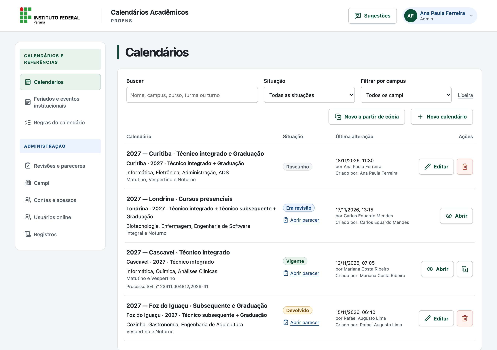
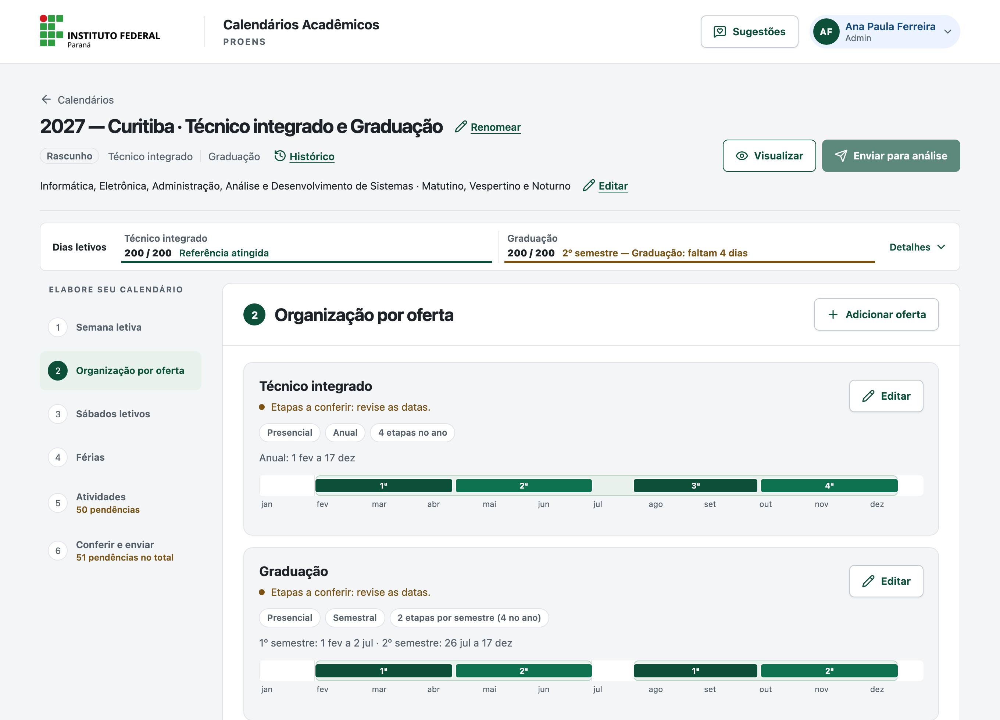
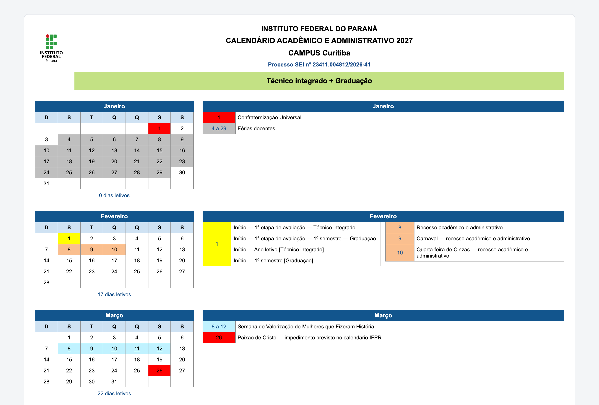
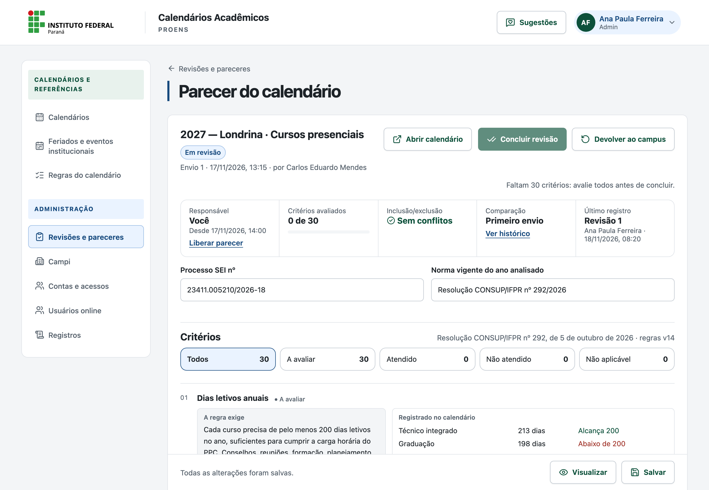

# Assistente de Calendários Acadêmicos — IFPR

Aplicação web da **DENTEC/PROENS** para apoiar os campi do Instituto Federal do Paraná na elaboração, conferência, revisão técnico-pedagógica e publicação de seus calendários acadêmicos.

> **Acesso à aplicação:** [calendario-academico-phi.vercel.app](https://calendario-academico-phi.vercel.app)  
> O sistema está em fase **alpha** e o acesso é feito com conta institucional (e-mail e senha).

## Para que serve

Elaborar um calendário acadêmico envolve conciliar feriados, férias, sábados letivos, etapas de avaliação, prazos docentes e exigências das resoluções institucionais — muitas vezes para vários cursos e regimes ao mesmo tempo.

O Assistente reúne todo esse fluxo em um só lugar:

- **Campi** montam seus calendários passo a passo, acompanham a contagem automática de dias letivos em tempo real e conferem pendências antes de enviar.
- **Pareceristas da PROENS** recebem os envios organizados em fila, analisam cada critério normativo com apoio do sistema e geram o parecer pronto para tramitação no SEI.
- **Administração** mantém a base institucional de feriados e eventos, gerencia campi e acessos e publica os calendários aprovados.

---

## Conheça a aplicação

### Painel de calendários

Na tela inicial, cada unidade acompanha seus calendários por ano letivo e situação — de rascunhos em elaboração a calendários vigentes com processo SEI registrado. Também é possível consultar calendários de outros campi como referência e criar um novo calendário do zero ou a partir de uma cópia.

### Elaboração guiada por etapas

O editor conduz o preenchimento em seis etapas claras: **Semana letiva**, **Organização por oferta**, **Sábados letivos**, **Férias**, **Atividades** e **Conferir e enviar**.

Cada calendário pode combinar diferentes ofertas (como Técnico integrado, Técnico subsequente e Graduação), em regime anual ou semestral, com períodos e etapas independentes. No topo da tela, o contador de dias letivos é atualizado automaticamente à medida que datas, feriados, férias e sábados são ajustados, sinalizando tanto o total anual quanto o equilíbrio por semestre.

### Prévia e impressão oficial

A qualquer momento é possível visualizar o calendário formatado no padrão institucional do IFPR, com destaque visual por tipo de data, contagem mensal de dias letivos e legenda automática. A prévia é preparada para impressão direta ou geração de PDF pelo navegador — incluindo a opção de manter datas internas visíveis apenas na versão completa, sem alterar a versão oficial.

### Revisão técnico-pedagógica e parecer

Quando o campus conclui o preenchimento e envia o calendário, ele entra na fila de **Revisões e pareceres** da PROENS. O parecerista avalia cada critério da norma vigente com o apoio dos dados já levantados pelo sistema, pode devolver o calendário com apontamentos objetivos para ajuste ou concluir a revisão e copiar o parecer formatado para o SEI.

---

## Como funciona o fluxo do calendário

1. **Rascunho** — O campus cria e edita livremente o calendário, acompanhando dias letivos e pendências.
2. **Enviado** — Com as pendências resolvidas, o calendário segue para a fila de análise da PROENS.
3. **Em revisão** — Um parecerista assume a análise e avalia os critérios da norma do ano.
4. **Devolvido** _(quando há ajustes)_ — O campus recebe a nota de devolução com os critérios apontados, faz as correções e reenvia.
5. **Revisado** — Todos os critérios estão atendidos e o calendário aguarda publicação.
6. **Vigente** — Publicado pela administração com o número do processo SEI. Se precisar de mudanças futuras, uma nova versão é aberta sem alterar o calendário vigente até a nova publicação.
7. **Arquivado** — Calendários substituídos ou encerrados permanecem disponíveis para consulta.

---

## Documentação e guias

Para aprofundar regras de negócio, acesso ou aspectos técnicos do projeto, consulte os guias em `docs/`:

- [Regras da aplicação](docs/uso.md) — perfis, ciclo de vida, contagem de dias letivos, férias, atividades, revisão e impressão.
- [Acesso e contas](docs/recuperacao-de-senha.md) — criação de contas, convites e recuperação de senha.
- [Desenvolvimento](docs/desenvolvimento.md) — preparação do ambiente local para quem vai contribuir com o código.
- [Verificação](docs/verificacao.md) — testes e checagens do projeto.
- [Arquitetura](docs/arquitetura-convex.md) · [Segurança](docs/seguranca.md) · [Implantação e operação](docs/implantacao-convex-vercel.md) · [Operações administrativas de dados](docs/migracao-schema.md) · [Pendências](docs/pendencias.md).

## Licença e autoria

Software disponibilizado sob a [licença MIT](LICENSE), com titularidade dos direitos patrimoniais do Instituto Federal de Educação, Ciência e Tecnologia do Paraná — IFPR. A unidade responsável pelo projeto é a DENTEC/PROENS. Consulte [Autoria e reconhecimento](AUTHORS.md) para os créditos.

Dependências e materiais de terceiros permanecem sujeitos às respectivas licenças e condições de uso. A licença do software não concede direitos sobre marcas e logotipos institucionais.
